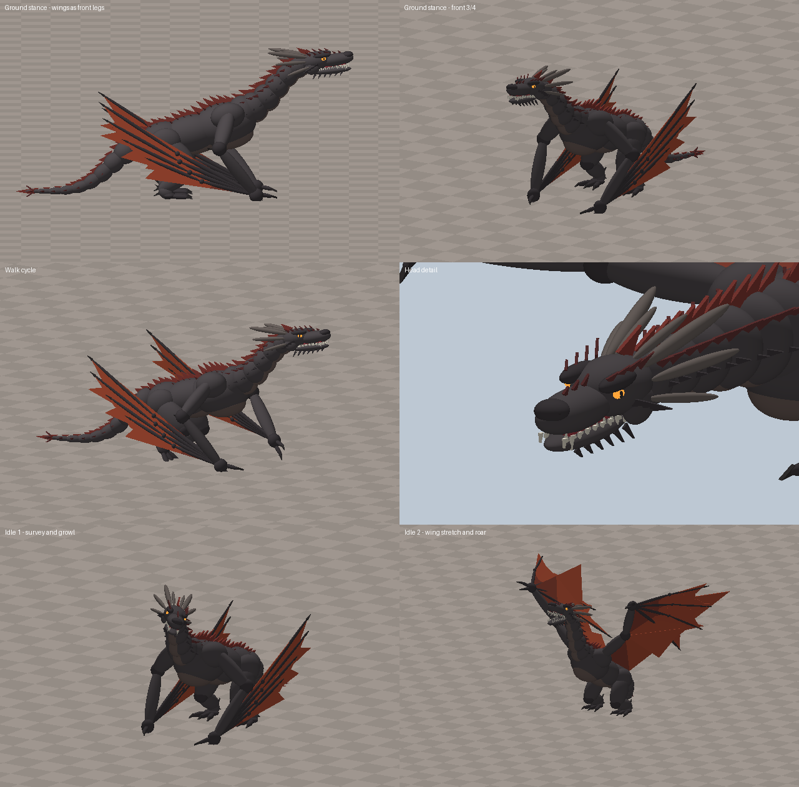
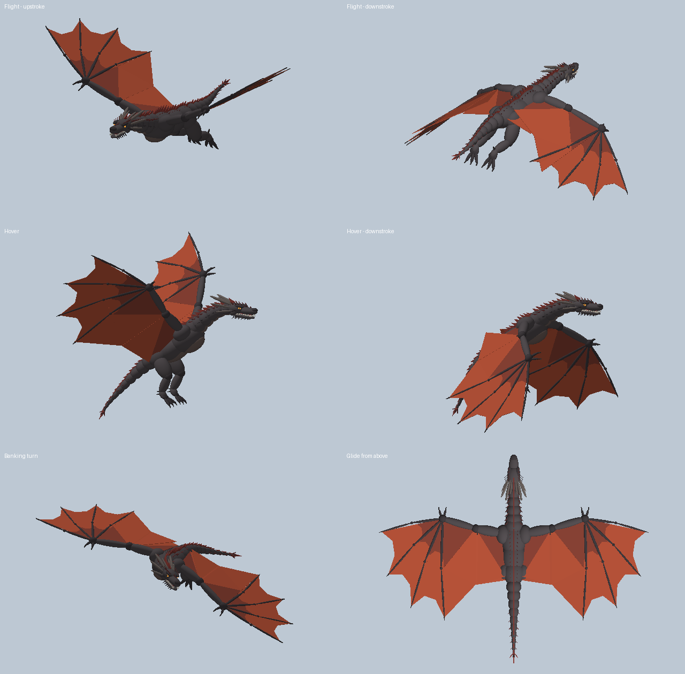

# Cinderwing

A second, separate dragon: a dark wyvern with red-orange wing membranes that
walks on its wings, flies under camera control, and appears as a rare secret
spawn in the volcanic biome. It is built entirely from parts by script, and its
animation is procedural, so there are no mesh or animation assets to upload.

The previews above are offline renders of the real part layout and poses. The
scripts have been syntax-checked with Luau but **have not been run inside
Roblox Studio yet**, so expect to do a first play-test pass.

## Install

Copy each file into the matching place in Studio (or sync this folder with
Rojo using `default.project.json`).

| File | Goes in | Type |
| --- | --- | --- |
| `src/ReplicatedStorage/Cinderwing/*.lua` | `ReplicatedStorage/Cinderwing` (a Folder) | ModuleScript each |
| `src/ServerScriptService/CinderwingSpawner.server.lua` | `ServerScriptService` | Script |
| `src/StarterPlayer/StarterPlayerScripts/CinderwingClient.client.lua` | `StarterPlayer/StarterPlayerScripts` | LocalScript |

Then tell it where the volcanic biome is: give the biome's part, model or
folder the CollectionService tag `VolcanicBiome`, or name it one of the names
in `Config.ZoneNames`. A single invisible, non-collidable part covering the
biome works well as a marker.

Nothing here touches the existing dragon.

## How it plays

- **Secret spawn.** Every `SpawnCheckInterval` seconds the server rolls
  `SpawnChance`. On a hit, one dormant Cinderwing appears at a random spot in
  the zone with no announcement, and leaves after `WildLifetime` seconds.
- **Bonding.** A player who finds it holds the prompt and becomes the dragon.
- **Ground.** WASD walks. The wing wrists are planted like front legs and step
  in diagonal pairs with the hind feet.
- **Idles.** Breathing and tail sway all the time, plus two occasional ones:
  a slow look-around with a growl, and a rearing wing stretch with a roar.
- **Flight.** Space takes off instead of jumping. W/S fly along the camera's
  look direction, so aiming the camera up and holding W climbs; A/D strafe.
  LeftShift boosts. Space again, or flying down onto the ground, lands.

To test quickly, set `DebugSpawnOnStart` (spawns one immediately) or
`DebugMorphOnJoin` (every player starts as the dragon) in `Config.lua`.

## Files

- `Config.lua` - spawn odds, speeds, camera, debug switches.
- `Rig.lua` - skeleton: joint names and rest positions.
- `Builder.lua` - `Builder.build()` returns the finished Model.
- `Animator.lua` - turns velocity and state into joint poses each frame.
